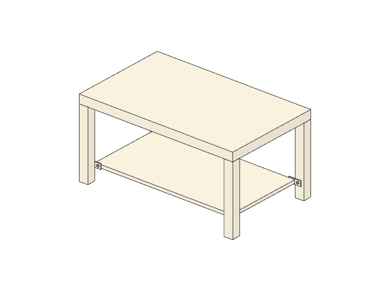

# manual-to-3d

[中文](README.zh-CN.md)

Turn a flat-pack furniture assembly manual into an interactive 3D step-by-step guide — from one sentence.

```
"LACK coffee table 90x55"  →  finds the product and its manual  →  Claude reads every page
→  animated 3D scene  →  checked against the manual's parts list  →  playable web guide
```



Live examples: [zhuanghaole.com](https://zhuanghaole.com) (six products, all generated by this pipeline).

Each guide has step-by-step animation, a parts list per step, read-aloud narration and hands-free voice commands ("next", "back", "repeat"). Inspired by [@nutlope's bygga](https://x.com/nutlope/status/2113715630386077804).

## How it works

1. **Find the manual.** Searches IKEA for the product, downloads the assembly PDF and reads the outer size from the product page. Or bring your own PDF from any brand.
2. **Transcribe.** Claude reads every page and copies the inventory and each step's printed "N×" counts — no guessing.
3. **Build the scene.** Claude writes a scene JSON (panels, hardware, coordinates, camera, animation) from the step pages and the transcription.
4. **Validate and repair.** A validator checks part counts against the manual, geometric overlap and floating hardware, and whether each new part is actually visible from that step's camera. Errors go back to Claude, up to 3 rounds; the best round wins.
5. **Render.** A single-file Three.js player (orthographic, IKEA-manual look) plays the scene.

A run takes about 6–12 minutes. All model calls go through your local `claude` CLI (`claude -p`), so there is no API key to configure.

## Install

Requirements: [Claude Code](https://claude.com/claude-code) logged in, Python 3.9+, poppler, and optionally Google Chrome (for thumbnails).

```bash
brew install poppler            # or: apt install poppler-utils
git clone https://github.com/imraywang/manual-to-3d ~/.claude/skills/manual-to-3d
```

## Use

As a Claude Code skill, just ask:

> Turn the IKEA LACK coffee table manual into a 3D guide

Or run it directly:

```bash
python3 ~/.claude/skills/manual-to-3d/scripts/make.py "LACK coffee table 90x55"
python3 ~/.claude/skills/manual-to-3d/scripts/make.py --url https://www.ikea.com/th/en/p/...
python3 ~/.claude/skills/manual-to-3d/scripts/make.py --pdf manual.pdf --name HEMNES --sub "Shoe cabinet" --dims 89x127x30
```

Then preview:

```bash
python3 -m http.server 8931 --directory ~/manual-to-3d
```

Open http://127.0.0.1:8931/ for the gallery, or `guide.html?scene=kallax-handmade` for the hand-written example.

Options: `--lang zh` (Chinese text and narration plus an English copy), `--pick N`, `--notes "…"`, `--reuse-extraction`, `--public`. Output goes to `~/manual-to-3d`; set `MANUAL_TO_3D_HOME` to change it.

## Publishing

`scripts/build_public.py` writes `dist/` — static files you can host anywhere — **without any manual page images**. Assembly manuals are copyrighted by their manufacturers; don't publish the `manuals/` folder.

## Limits

- Works best on panel and frame furniture: cabinets, shelves, tables, stools, chests of drawers.
- Bent wood, upholstery and mechanism-heavy products come out poorly; steps that 3D can't show fall back to a crop of the manual illustration.
- Generated guides can be wrong in ways the validator can't see (a part mounted backwards). Always follow the paper manual.
- Script logs and validator messages are in Chinese for now; the scene format spec fed to the model is in Chinese too (the model handles it fine).

## Layout

```
SKILL.md              instructions for Claude Code
scripts/make.py       one-command entry point
scripts/fetch_manual.py, pipeline.py, validate.py, solids.py, translate.py, build_cases.py, build_public.py, fix_public.py
assets/guide.html     the 3D player (single file, Three.js from a CDN)
assets/index.html     the gallery
references/           scene format, validator rules, troubleshooting, hand-written example scene
```

## License

MIT. Not affiliated with or endorsed by IKEA or any furniture brand; product names are trademarks of their owners.
